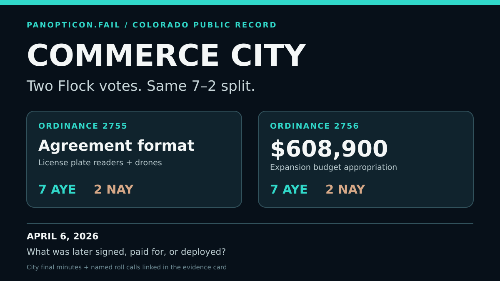
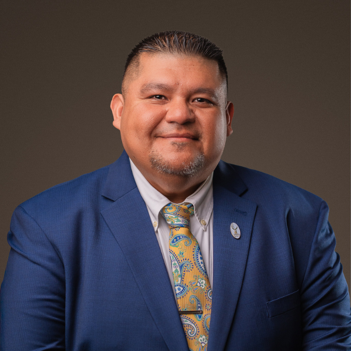
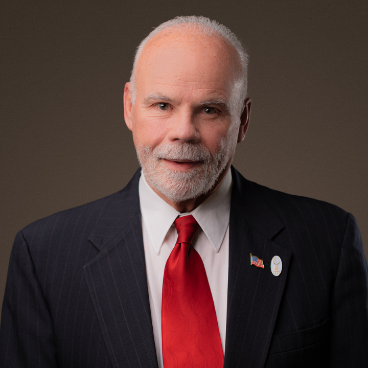
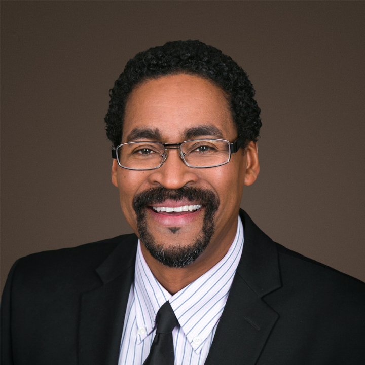

# Commerce City: two Flock votes, 7–2 each

**April 6, 2026 · Commerce City Council, Colorado · Public-record evidence card**

The council approved **Ordinance 2755**, authorizing the format of an agreement with Flock Group for a long-term lease of license plate recognition cameras, drones, and other cameras. In a **separate vote**, it approved **Ordinance 2756**, a **$608,900 budget appropriation** for the Flock expansion project. Each final ordinance passed **7 Aye to 2 Nay**. The city's [final minutes, pages 3–4](https://commerce.legistar.com/View.ashx?GUID=C0ED2DA4-496A-4790-AA64-CB17DE0B1BBB&ID=1371690&M=M#page=3) name every voter.

**Open question:** Was the agreement later signed by the city, and what was actually paid for or deployed? These decision records establish the approvals. They do not establish later execution, payment, or deployment.

## Recorded votes on both final ordinances

The same nine positions appear on each final vote. These are the city's original published portrait files, preserved byte for byte. The photograph dates are not established.

| City-published portrait | Person named in roll call | Ord 2755 | Ord 2756 |
| --- | --- | :---: | :---: |
|  | Jose Guardiola | **Aye** | **Aye** |
|  | Rocky Teter | **Aye** | **Aye** |
|  | Joanna Sandoval | **Aye** | **Aye** |
|  | Craig Kim | **Aye** | **Aye** |
|  | Charles Dukes | **Aye** | **Aye** |
|  | Stefanie Trujillo | **Aye** | **Aye** |
|  | Lori Young | **Aye** | **Aye** |
|  | Steven J. Douglas | **Nay** | **Nay** |
|  | Susan Noble | **Nay** | **Nay** |

The minutes also record a **separate pilot-program amendment that failed 2–7** before the Ord 2755 final vote. Its positions are not counted here as votes on the final ordinance.

## Read the records

1. [City Council final minutes, pages 3–4](https://commerce.legistar.com/View.ashx?GUID=C0ED2DA4-496A-4790-AA64-CB17DE0B1BBB&ID=1371690&M=M#page=3) and the [accessible text view](https://commerce.legistar.com/View.ashx?GUID=C0ED2DA4-496A-4790-AA64-CB17DE0B1BBB&ID=1371690&M=MADA). The [preserved PDF](../../fixtures/co-commerce/minutes-2026-04-06.pdf) matched the city's live PDF byte for byte when checked on November 10, 2026.
2. Official legislation pages for [Ord 2755](https://commerce.legistar.com/LegislationDetail.aspx?GUID=B239266E-1D85-4F30-95EC-AEC4C1D7723B&ID=7929879&Options=&Search=) and [Ord 2756](https://commerce.legistar.com/LegislationDetail.aspx?GUID=B657853C-8876-4D63-AB2B-765A9AD2FA1F&ID=7927351&Options=&Search=) show separate final actions and the budget amount.
3. Preserved item-specific roll calls for [Ord 2755](../../fixtures/co-commerce/votes-70384-ord-2755.json) and [Ord 2756](../../fixtures/co-commerce/votes-70385-ord-2756.json). The [source checksums](../../fixtures/co-commerce/SHA256SUMS) and [portrait provenance](../official-portraits.md) let readers verify the original bytes and image identities.

This card describes documented decisions. It makes no claim about an executed contract, actual spending, equipment deployment, or any official's motive.
